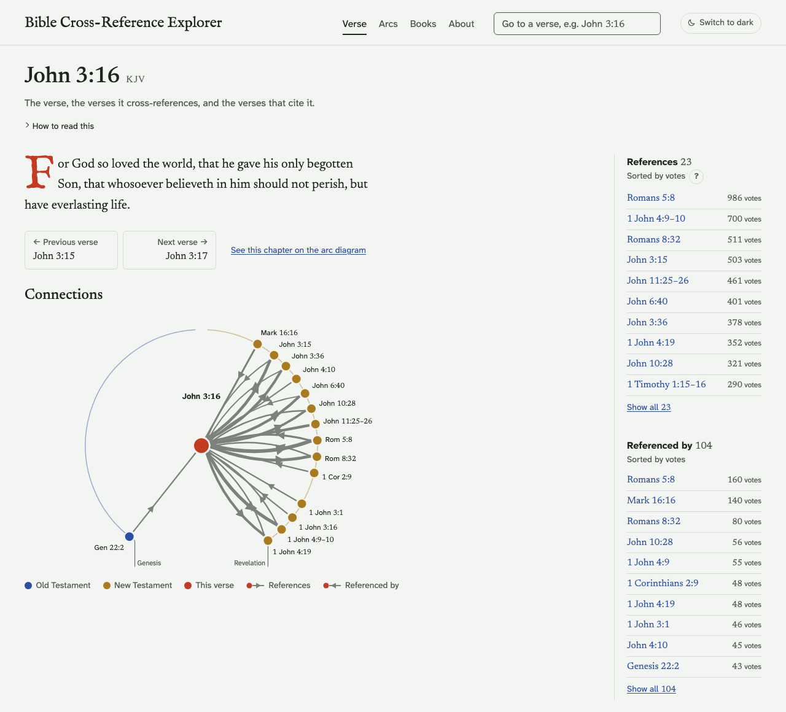
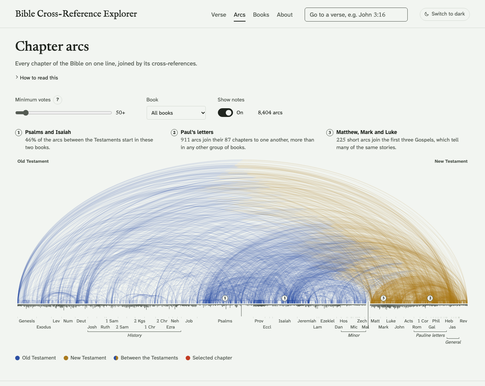
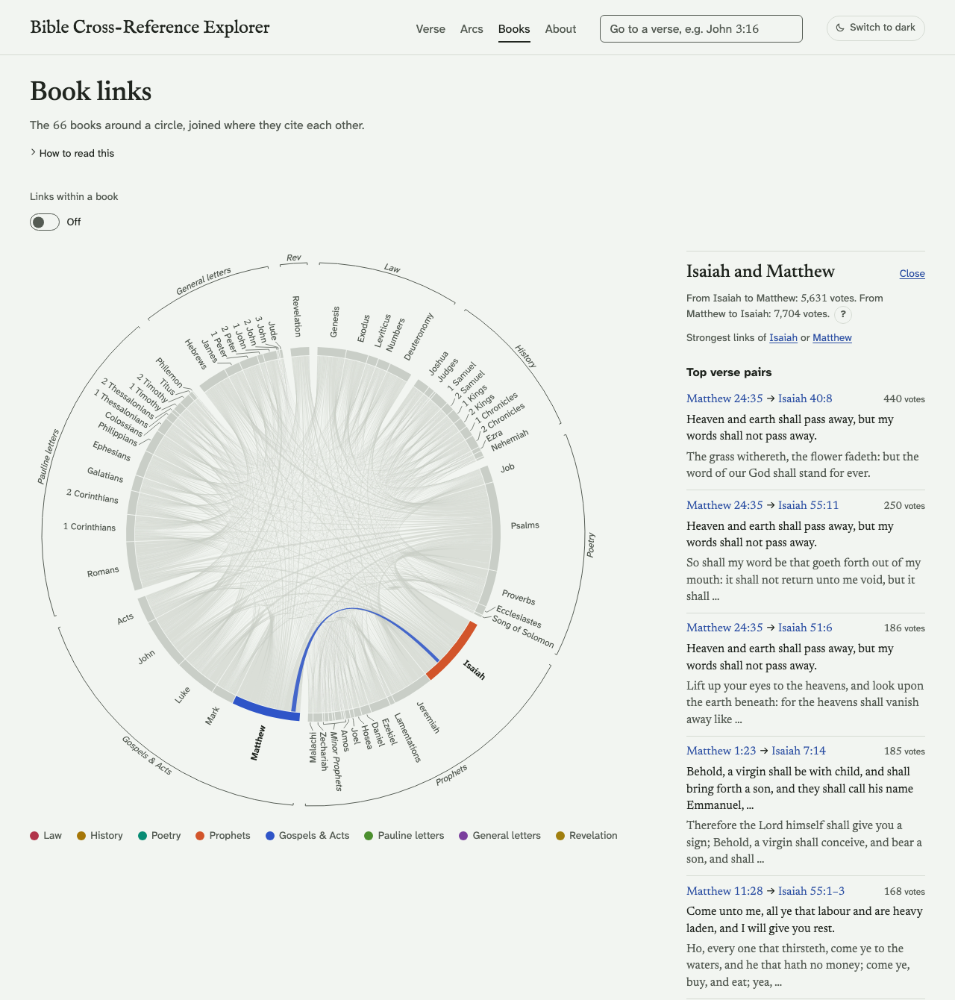
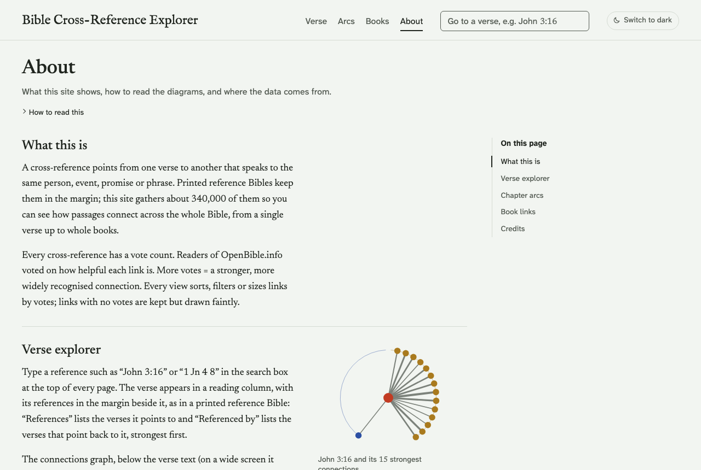

# Bible Cross-Reference Explorer

**Live site: https://ryan2706.github.io/bible-xref/**

A static website that shows how verses connect across the whole Bible. It draws about
340,000 cross-references from [OpenBible.info](https://www.openbible.info/labs/cross-references/),
each with reader votes for how helpful the link is, alongside the King James Version text.
The site has four views:

### Verse explorer

Look up any verse ("John 3:16", "1 jn 4 8"). The verse sits in a reading column with its
references in the margin, as in a printed reference Bible, above a graph of its 15 strongest
connections arranged round a circle in canonical order. Hovering a reference lights it up in the graph.

[](https://ryan2706.github.io/bible-xref/#/verse/John.3.16)

### Chapter arcs

Every chapter of the Bible on one line, joined by arcs for its cross-references: blue within the
Old Testament, gold within the New, and both colours on arcs between the two. You can filter by
votes or by book, and zoom in on a book.

[](https://ryan2706.github.io/bible-xref/#/arcs)

### Book links

The 66 books around a circle, coloured by section and joined by ribbons wherever they cite
each other. Pick a book or a pair of books to see the verse pairs that link them most strongly.

[](https://ryan2706.github.io/bible-xref/#/books?pair=Isa-Matt)

### About

What the site shows, how to read each diagram, and where the data comes from.

[](https://ryan2706.github.io/bible-xref/#/about)

Every view works with a keyboard and on touch screens, has light and dark themes, and keeps its
state in the URL, so you can share any link.

## Running it locally

You need Node.js 24 (the version CI uses).

```sh
npm install
npx playwright install chromium   # once: the tests use it, and so does the build's preview image
npm run dev                       # http://localhost:5173/bible-xref/
npm test                          # production build, then every Playwright test against it
```

Other scripts: `npm run build` writes the production site to `dist/`, `npm run preview`
serves that build, and `npm run build:data` regenerates only the data.

## How the data pipeline works

The site has no backend. Everything it shows comes from static JSON built ahead of time:

1. **Raw sources** live unmodified in [`data-raw/`](data-raw/README.md): OpenBible.info's
   `cross_references.txt` and the KJV as `kjv.json`. They are committed, so builds are reproducible,
   and never edited by hand.
2. **[`scripts/build-data.mjs`](scripts/build-data.mjs)** (`npm run build:data`, run automatically
   before `dev` and `build`) parses both sources, gives each verse an integer ID in canonical order
   (Genesis 1:1 = 0, Revelation 22:21 = 31,101) and cleans known quirks: it maps a verse missing from the
   KJV numbering, drops links with negative votes, and strips KJV margin notes that leaked into 19 verses.
   It writes `public/data/`:
   - `books.json`: the 66 books, their sections, chapters and verse counts
   - `verses/<book>.json` and `xrefs/<book>.json`: text and cross-references per book, loaded only
     when needed
   - `overview.json`: chapter-to-chapter totals for the arc diagram
   - `book-matrix.json`: book-to-book totals for the chord diagram
   - `search.json`, plus small SVG thumbnails for the About page

   The script fails the build if any file grows over 5 MB, a cross-reference row can't be parsed or a
   cleanup rule stops matching, so bad data never deploys.
3. **[`scripts/build-og.mjs`](scripts/build-og.mjs)** (run before `build`) draws the 1200×630 link
   preview image from `overview.json`, using the arc diagram's dark palette.
4. **Vite** bundles the vanilla JavaScript and D3 front end. Each view fetches only the JSON files it needs.

Pushing to `main` runs [`.github/workflows/deploy.yml`](.github/workflows/deploy.yml), which runs
`npm test` (a fresh data build, the production build and the Playwright suite) and publishes `dist/`
to GitHub Pages only if every test passes.

## Credits

- **Cross-references**: [OpenBible.info](https://www.openbible.info/labs/cross-references/), licensed
  under [Creative Commons Attribution 4.0 (CC BY 4.0)](https://creativecommons.org/licenses/by/4.0/).
- **Bible text**: the King James Version, which is in the public domain (outside the UK, where it is
  under Crown copyright), from [thiagobodruk/bible](https://github.com/thiagobodruk/bible).
- **Inspiration**: the arc diagram is inspired by
  [Chris Harrison and Christoph Römhild's 2007 visualization](https://www.chrisharrison.net/index.php/Visualizations/BibleViz)
  of the Bible's cross-references.
- **Fonts**: IM Fell English, Newsreader and Atkinson Hyperlegible Next, all under the SIL Open Font License.

## License

The code is released under the [MIT License](LICENSE). The data keeps its own licenses (above).
